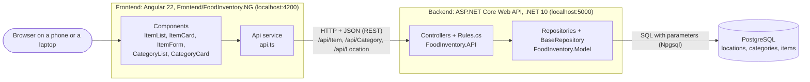
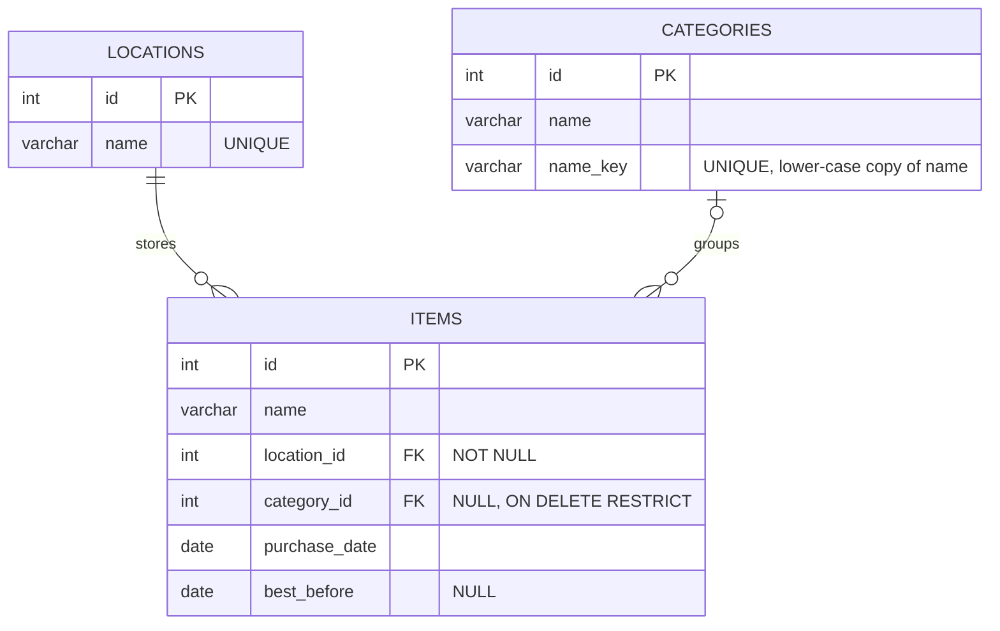

# Architecture

How the app is built and why, with pointers to the code. Lecture 1 calls this the blueprint of the system: a layered full-stack application.

## Layers

| Layer (lecture 1) | Where | What it does |
|---|---|---|
| Presentation | `Frontend/FoodInventory.NG/src/app` | Shows the data, checks the form, calls the API through one service |
| Application (Web API) | `Backend/FoodInventory.API` | Receives HTTP requests, checks the rules, answers with JSON and status codes |
| Data | `Backend/FoodInventory.Model` + PostgreSQL | One repository per table runs the SQL; the database keeps the data and enforces the keys |

Each layer only talks to the next one, as in lecture 5's restaurant picture: the frontend is the dining room, the API is the waiter
and the backend is the kitchen. The API is stateless (lecture 4): every request carries everything it needs.

## Database

- Every item has exactly one storage location and at most one category. A category that items still use cannot be deleted:
  the database refuses it (`ON DELETE RESTRICT`), and the API answers first with a clear 409 message.
- `name_key` makes category names unique ignoring case ("Dairy" = "dairy"); the API fills it with `ToLowerInvariant()`.
- Dates are plain `date` values (no time, no time zone), sent as `"YYYY-MM-DD"`.
- Scripts: `Database/create_tables.sql`, then `Database/seed_data.sql` (one transaction, runs once).

## One request from start to end: adding an item

1. **Form** (`item-form`): the fields are two-way bound with `[(ngModel)]`. `validateItem` (`rules.ts`) checks them; a wrong field
   gets its message and nothing is sent.
2. **Service** (`api.ts`): `POST http://localhost:5000/api/Item` with
   `{"name":"Milk","locationId":1,"categoryId":1,"purchaseDate":"2026-11-01","bestBefore":"2026-11-06"}`.
3. **ASP.NET Core** (`Program.cs`): CORS lets the Angular app call the API; the JSON is bound to `ItemRequest`
   (malformed JSON gets 400 `{"message":"The request body is not valid JSON."}`).
4. **Controller** (`ItemController.Post`): `Rules.Item` checks the same rules again, and the repositories check that the location and
   the category exist. Errors: 400 `{"errors":{"name":"Enter a name."}}`.
5. **Repository** (`ItemRepository.InsertItem`): `INSERT ... RETURNING id` with parameters, then `GetItemById` joins the location and
   category names. Answer: **201 Created** with the item as JSON.
6. **Back in Angular**: the form emits `saved` with the new item; `ItemList` shows "Saved Milk." and loads `GET /api/Item` again
   (sorted by the database). The signals change and the page shows the new list.

## API

| Method and path | Success | Errors |
|---|---|---|
| `GET /api/Item` | 200, soonest best before date first | |
| `GET /api/Item/{id}` | 200 | 404 `Item not found.` |
| `POST /api/Item` | 201 + the item | 400 one message per field |
| `PUT /api/Item/{id}` (the whole item) | 200 + the item | 400, 404 |
| `DELETE /api/Item/{id}` | 204 | 404 |
| `GET /api/Category` | 200, with `itemCount`, by name | |
| `POST /api/Category` | 201 | 400 name, 409 `Dairy already exists.` |
| `PUT /api/Category/{id}` | 200 | 400, 404, 409 |
| `DELETE /api/Category/{id}` | 204 | 404, 409 `Dairy is used by 1 item and cannot be deleted.` |
| `GET /api/Location` | 200 (Fridge, Freezer, Pantry) | |

Any unexpected error: 500 `{"message":"Something went wrong on the server."}`. Swagger documents it all at `/swagger`.

## Validation in two places

The form checks first, so the user gets a message right away (lecture 5: real-time validation, smart error messages). The API checks
again, because a request can come from anywhere (Swagger, Postman). Both use the same rules and messages: `Rules.cs` and `rules.ts`.

## Security, ethics and accessibility (lecture 2)

- **SQL injection:** every query uses parameters (`@name`), never text glued into SQL.
- **XSS:** Angular escapes everything shown with `{{ }}`.
- **CORS:** only the Angular app (`http://localhost:4200`) may call the API from a browser.
- **Secrets:** a shared cloud database gets its connection string from an environment variable, never from a file in git.
- **Privacy:** no accounts and no personal data, only the food list.
- **Accessibility:** a label for every field; `aria-invalid` and `aria-describedby` link a field to its message, and the focus moves to
  the first wrong field. Buttons and fields are at least 44 px and text is at least 16 px. All text has at least 4.5:1 contrast
  (ink on background 9.9:1, error text 6.9:1, grey text 5.6:1) and field borders 3:1. Everything works with the keyboard.
  Screen readers announce "Saved Milk." and "Deleted Milk.": the message is a `role="status"` live region that always stays in the page.

## Tests

- **xUnit** (`Backend/FoodInventory.Tests`, 26 tests): every test runs the real API on a brand-new PostgreSQL database built from the
  real scripts. They cover create/read/replace/delete, every validation message, ids sent as text, malformed JSON, the sort order,
  category rules and the foreign key.
- **Vitest** (`Frontend/FoodInventory.NG`, 16 tests): the form rules and "today" in the local time zone, plus a spec for every
  component with TestBed and a mocked API (`vi.fn()`), e.g. Delete asks "Delete Milk?", Cancel keeps it, OK says "Deleted Milk.".
- **By hand:** the demo script in the README, at 360 px.

## Strengths and limitations

| Strengths | Limitations (and what would fix them) |
|---|---|
| Layered like the course project: easy to explain and to change one layer at a time | No login: anyone who can reach the app can change the list (authentication, a later lecture) |
| Plain SQL in repositories: you can read exactly what the database does | One shared inventory: no households or users (would need accounts and a households table) |
| The same rules and messages in the form and in the API | Synchronous repositories: simple, but async would serve more users at once |
| Tests run against a real PostgreSQL database | Runs on localhost: deploying would need a host for the API and a cloud database |
| Phone-first, accessible layout | No paging: fine for a household list, not for thousands of items |

## Business value (lecture 1)

Households waste the most food: 60% of the 1.05 billion tonnes wasted in 2022 (UNEP Food Waste Index Report 2024). The app helps a
household waste less, and less waste saves money. As a product it could grow with accounts, reminders before food goes off, and
shared households. That would bring new requirements: authentication, hosting, and GDPR for personal data.

## Questions for the oral exam

- **What is a Web API, and why REST?** A contract over HTTP: endpoints, methods, JSON in and out, status codes. REST uses the standard
  methods: GET reads, POST creates, PUT replaces, DELETE deletes. It is stateless. See `Controllers/`.
- **What does a repository do?** It holds all the SQL for one table. `BaseRepository` (from the course) opens the connection and runs the
  command; controllers never write SQL. See `FoodInventory.Model/Repositories`.
- **Where is dependency injection?** `builder.Services.AddScoped<ItemRepository, ItemRepository>()` in `Program.cs`. ASP.NET Core creates
  one repository per request and passes it to the controller's constructor.
- **What do `[ApiController]` and `[Route("api/[controller]")]` do?** An invalid body gets a 400 automatically, and the URL comes from
  the class name: `ItemController` is `/api/Item`.
- **How do the components talk to each other?** `@Input()` passes data down (list to card, list to form). `@Output()` reports events up
  (the card's edit and remove; the form's saved, which carries the saved item, and closed). The `Api` service is shared by all of them.
- **What is two-way binding?** `[(ngModel)]` keeps a form field and a variable equal in both directions (`item-form.html`).
- **Why signals?** The app is zoneless: Angular re-renders when a signal changes, for example when the HTTP answer arrives.
- **How does routing work?** `app.routes.ts` maps `/items` and `/categories` to components. The links use `routerLink`, and the page
  appears in `<router-outlet />`.
- **What happens when you delete a category that is in use?** The API counts its items and answers 409 with the count; the database
  would refuse it anyway (`ON DELETE RESTRICT`).
- **Why are dates text?** A best before date has no time and no time zone. "Today" comes from the local year, month and day
  (`todayLocal`), because `toISOString()` gives the UTC day, which is wrong around midnight.

## Where the course is in this project

Page = page of the lecture PDF.

| Lecture, page | The course | In this project |
|---|---|---|
| L01 p.14 | Project: software product, written report (max 10 pages), individual oral exam | This repository; facts for the report here and in `BACKLOG.md` |
| L01 p.15 | Do not share the project outside the group | Keep the GitHub repository private; share the Figma file with the group only |
| L01 p.16 | CBS rules for generative AI (my.cbs.dk/ai) | Follow them; be able to explain every file |
| L01 p.27-32 | Scrum: team, events, Product Backlog, Increment | `BACKLOG.md` |
| L01 p.40 | Angular, ASP.NET Core (C#), PostgreSQL | The stack |
| L01 p.50 | Layered architecture, REST API | [Layers](#layers) |
| L02 p.17-20 | User stories: "As a ... I want ... so that ..." | `BACKLOG.md` |
| L02 p.18 | INVEST: every story is testable, with acceptance criteria | `BACKLOG.md`, acceptance criteria |
| L02 p.21-22 | Use case: preconditions and main flow | [One request from start to end](#one-request-from-start-to-end-adding-an-item) |
| L02 p.24, 31 | Wireframes, then UI design, then a prototype | Figma: 1 Wireframes, 2 UI design (press Play) |
| L02 p.29-31 | Visual hierarchy, consistency, colours, type sizes; primary, secondary and ghost buttons | `styles.css`; Button Primary, Secondary, Quiet |
| L02 p.30 | Feedback elements: loading states, error messages, success notifications | "Loading your items..."; messages under fields; "Saved Milk." / "Deleted Milk." |
| L02 p.32 | Mobile first; loading and error states; accessibility | 360 px layout; loading, empty and error states; WCAG contrast |
| L02 p.38-40 | Definition of Done | `BACKLOG.md` |
| L02 p.51-53 | Privacy, SQL injection, XSS, accessibility | [Security, ethics and accessibility](#security-ethics-and-accessibility-lecture-2) |
| L04 p.7, 17 | Web API: a contract, stateless, REST, JSON | `Controllers/` |
| L04 p.27 | Resources with GET, POST, PUT, DELETE | [API](#api) |
| L04 p.30 | `dotnet new sln`, `dotnet new webapi --use-controllers`, `dotnet sln add`; remove `UseHttpsRedirection` | `Backend/FoodInventory.slnx`, `FoodInventory.API` |
| L04 p.31 | Create the database in pgAdmin; run the script in the Query Tool | README, Run it |
| L04 p.32 | `dotnet new classlib -n ....Model`; packages Npgsql and Microsoft.Extensions.Configuration | `FoodInventory.Model` |
| L04 p.33 | Connection string `AppProgDb` in `appsettings.json`; folders `Entities` and `Repositories` | The same |
| L04 p.34 | `BaseRepository` | `Repositories/BaseRepository.cs`, unchanged |
| L04 p.35 | An entity class with an `(int id)` constructor and `DateOnly` | `Entities/` |
| L04 p.36 | One repository per table; `AddScoped`; project reference; `<Nullable>disable</Nullable>` | `Program.cs`, the `.csproj` files |
| L04 p.37 | A controller in `Controllers/`; `dotnet run --project`; `/api/Student` | `ItemController` is `/api/Item` |
| L04 p.38 | Swashbuckle: `AddSwaggerGen`, `UseSwagger`, `UseSwaggerUI`, launch URL `swagger` | `Program.cs`, `launchSettings.json` |
| L05 p.22-25 | A component is a class, a template, styles and metadata | One folder per component |
| L05 p.27 | Input (parent to child), Output (child to parent), shared services | `ItemCard`, `CategoryCard`, `ItemForm`; the `Api` service |
| L05 p.35-37 | Clear labels; feedback while loading; helpful errors with a way to recover | Labels; "Loading your items..."; "Try again" |
| L05 p.51-52 | Node.js LTS; `npm install -g @angular/cli` | README, Run it |
| L05 p.53-54 | `ng new ....NG` in `Frontend/`, CSS, no SSR; `ng serve` | `Frontend/FoodInventory.NG` |
| L05 p.56-57 | `ng generate component`; `ng generate interface` in `model/` | `item-card/` and the others; `model/item.ts` |
| L05 p.60-63 | A list and a card: `@for`, `@Input() student!` | `ItemList` + `ItemCard`, `CategoryList` + `CategoryCard` |
| L05 p.68 | Routes, `RouterLink`, a nav list, `<router-outlet />` | `app.routes.ts`, `app.html` |
| E02.1 p.1 | Scrum team of 3-4, registered on Digital Exam, with an idea of its own | The Product Goal in `BACKLOG.md` |
| E02.1 p.1-2 | PostgreSQL and pgAdmin; a cloud database such as Supabase for the team | README, Run it |
| E04.1 p.1 | Test your API with Postman | README: `GET http://localhost:5000/api/Item` |

Kept different on purpose:

| Lecture, page | The course | Here, and why |
|---|---|---|
| L05 p.53 | Keep zone.js | Zoneless with signals, like the professor's own project files (they have no zone.js) |
| L05 p.62-63 | `track $index` | `track item.id`: each card stays with its item when the list changes |
| L05 p.65 | A table with `border` and `cellpadding` | Cards styled with CSS: a table does not fit a 360 px phone |
| L05 p.58, 61 | Data typed into the component | Data from the API |
