# Food inventory

[](#live-demo)

Track the food you have at home: add groceries when you buy them, see what should be eaten first, tap **Ate one** when you eat something. No login: one shared inventory for the household.

Why: in 2022 the world wasted 1.05 billion tonnes of food, and 60% of it in households ([UNEP Food Waste Index Report 2024](https://www.unep.org/news-and-stories/press-release/world-squanders-over-1-billion-meals-day-un-report)). Seeing what you have, soonest best before date first, helps a household eat it in time. Design (wireframes, UI design, prototype): [Figma](https://www.figma.com/design/NcVVu2BWhFgR8RkuFfXbg9).

Group project for the CBS course *Designing and Developing Digital Business Applications*: a PostgreSQL database, an ASP.NET Core Web API (C#) and an Angular frontend, built the way the course project CourseAdminSystem is built in the lectures.

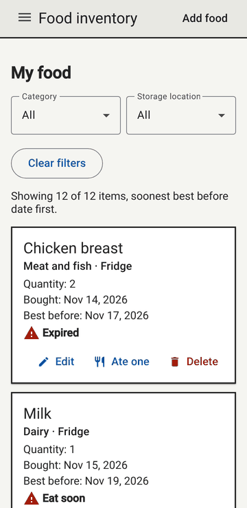

## Table of contents

- [Live demo](#live-demo)
- [Architecture](#architecture)
- [Tech stack](#tech-stack)
- [Structure](#structure)
- [Installation](#installation)
  - [Prerequisites](#prerequisites)
  - [1. Get the code](#1-get-the-code)
  - [2. Database](#2-database)
  - [3. Backend](#3-backend)
  - [4. Frontend](#4-frontend)
  - [Testing](#testing)
- [Screenshots](#screenshots)
- [API endpoints](#api-endpoints)
- [Database](#database)
- [Course concepts in this project](#course-concepts-in-this-project)
- [Credits](#credits)

## Live demo

Not deployed yet. The app runs on your own computer (see [Installation](#installation)). A deployment (for example with the cloud credits of the GitHub Student Developer Pack) can be linked here later: `https://<to be added>`.

## Architecture

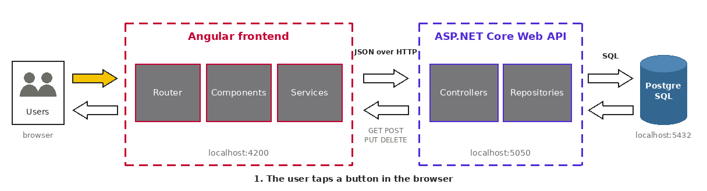

```
            ┌──────────────────────────────────┐  JSON over HTTP  ┌──────────────────────────────┐   SQL   ┌────────────┐
 Users ───► │ Angular frontend                 │ ───────────────► │ ASP.NET Core Web API         │ ──────► │ PostgreSQL │
 (browser)  │ Router → Components → Services   │ ◄─────────────── │ Controllers → Repositories   │ ◄────── │  database  │
            └──────────────────────────────────┘  GET POST PUT    └──────────────────────────────┘         └────────────┘
                     localhost:4200                 DELETE                 localhost:5050                  localhost:5432
```

- The **Router** shows the component that belongs to the address (`app.routes.ts`).
- The **Components** show the data and react to the user; they keep what the API sent in signals.
- The **Services** send HTTP requests to the Web API with `HttpClient` and return Observables.
- The **Controllers** receive the requests, check the input and answer with JSON and a status code.
- The **Repositories** run the SQL in PostgreSQL (through Npgsql).

## Tech stack

| Layer | Technology |
|---|---|
| Database | PostgreSQL 16 (pgAdmin to look at it) |
| Backend | ASP.NET Core Web API, C#, .NET 10, Npgsql 10, Swagger (Swashbuckle) |
| Backend tests | xUnit, Moq |
| Frontend | Angular 22, TypeScript, Angular Material |
| Frontend tests | Karma and Jasmine, in Chrome |

## Structure

```
food-inventory
├── Database
│   ├── setup.sql              one command: creates the database if missing, then runs food_inventory.sql
│   └── food_inventory.sql     the 3 tables and the example rows
├── docs                       the pictures of this README
├── Backend
│   ├── FoodInventory.slnx
│   ├── FoodInventory.API      the Web API
│   │   ├── Controllers        FoodItem, Category, StorageLocation: the endpoints
│   │   ├── Properties         launchSettings.json: port 5050
│   │   ├── Program.cs         dependency injection, Swagger, CORS
│   │   └── appsettings.json   the connection string AppProgDb
│   ├── FoodInventory.Model    data and database access
│   │   ├── Entities           one class per table, with the validation rules
│   │   └── Repositories       BaseRepository and one repository per entity: the SQL
│   └── FoodInventory.Tests    xUnit + Moq tests of the controllers
└── Frontend
    └── FoodInventory.NG       the Angular project (like the course's CourseAdminSystem.NG)
        └── src/app
            ├── http-common.ts          the only place with the address of the API
            ├── model                   interfaces: FoodItem, Category, StorageLocation
            ├── services                one service per controller, and notification-service (snackbars)
            ├── food-item-list          start page: filters and the cards
            ├── food-item-card          one food item (Material card) with Edit, Ate one, Delete
            ├── add-food-item           reactive form with Angular Material
            ├── edit-food-item          template form with two-way data binding
            ├── category-list           add, rename, delete categories
            ├── storage-location-list   add, rename, delete storage locations
            └── app.ts, app.html, app.routes.ts, app.config.ts   toolbar with the menu, routes
```

## Installation

### Prerequisites

Already installed:

- [PostgreSQL](https://www.postgresql.org/download/) with pgAdmin
- [.NET SDK 10](https://dotnet.microsoft.com/download)
- [Node.js 24](https://nodejs.org/en/download/) (with npm)
- Angular CLI: `npm install -g @angular/cli`

### 1. Get the code

```shell
git clone https://github.com/Davidee0/food-inventory.git
cd food-inventory
```

### 2. Database

One command creates the database `food_inventory`, its tables and the example rows. It asks for the password of the user `postgres`. Running it again changes nothing.

```shell
psql -h localhost -U postgres -f Database/setup.sql
```

Without `psql`: in pgAdmin create a database named `food_inventory`, open the Query Tool on it, open `Database/food_inventory.sql` and run it.

### 3. Backend

If your PostgreSQL password is not `postgres`, change it in the connection string `AppProgDb` in `Backend/FoodInventory.API/appsettings.json`.

```shell
cd Backend
dotnet build
dotnet run --project FoodInventory.API
```

The API runs on `http://localhost:5050`. Its documentation (Swagger) is on `http://localhost:5050/swagger`.

### 4. Frontend

In a second terminal:

```shell
cd Frontend/FoodInventory.NG
npm install
ng serve
```

The app runs on `http://localhost:4200`.

### Testing

```shell
cd Backend
dotnet test
```

```shell
cd Frontend/FoodInventory.NG
ng test --watch=false
```

`ng test` opens Chrome through Karma (`karma.conf.js`). Without a screen, add `--browsers=ChromeHeadless`.

## Screenshots

Taken from the running app at phone width (360 px).

| My food: sorted by best before date, with the expiry warning | Filters by category and storage location |
|---|---|
| 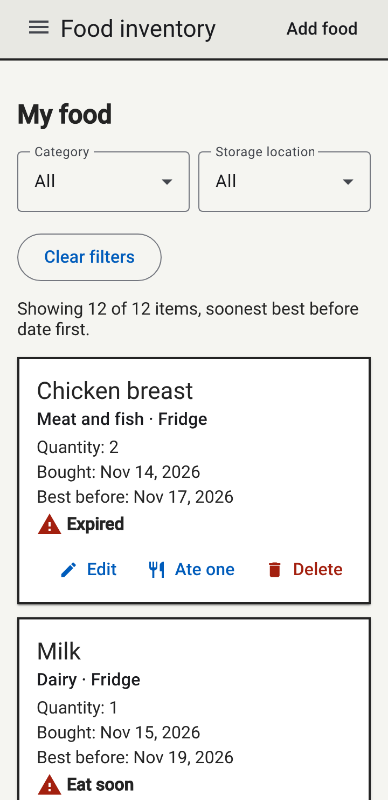 | 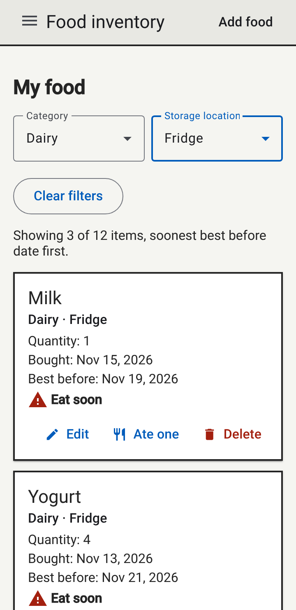 |

| Add food: validation messages, Add disabled | Add food: valid form |
|---|---|
| 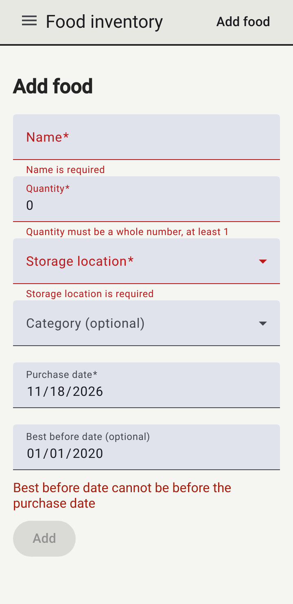 | 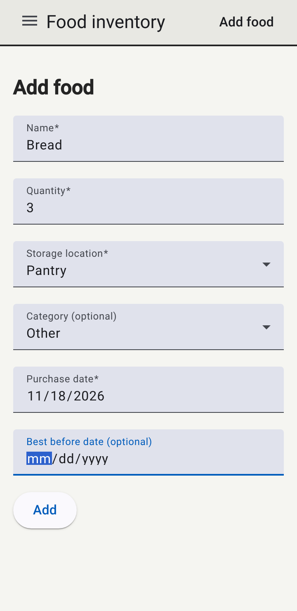 |

| Edit food: "Error in data" instead of the Update button | Edit food: pre-filled form |
|---|---|
| 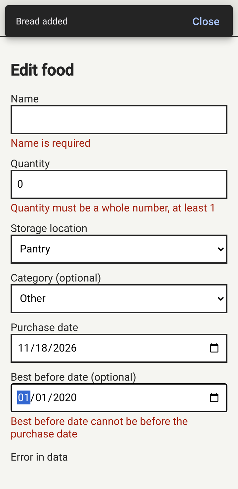 | 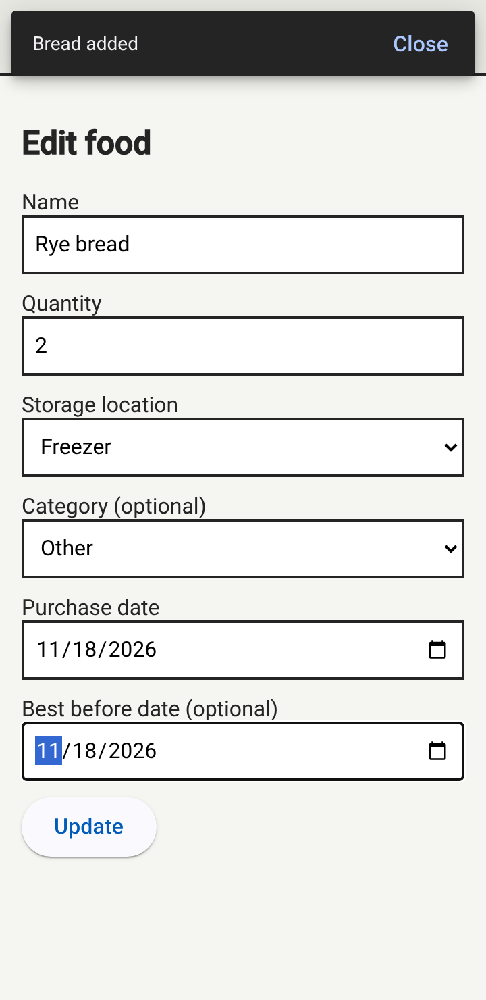 |

| Ate one: the quantity goes down, a snackbar confirms (the last one is deleted, after a question) | The menu |
|---|---|
| 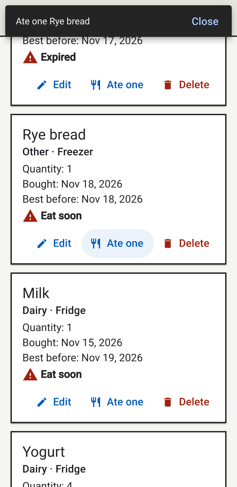 | 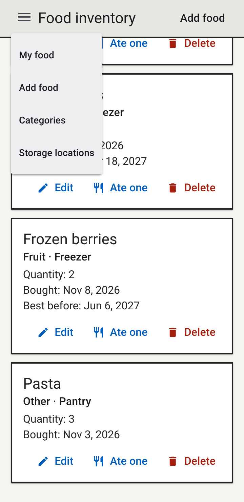 |

| Categories: a category that still has food cannot be deleted (the API's message in a snackbar) | Storage locations: the same |
|---|---|
| 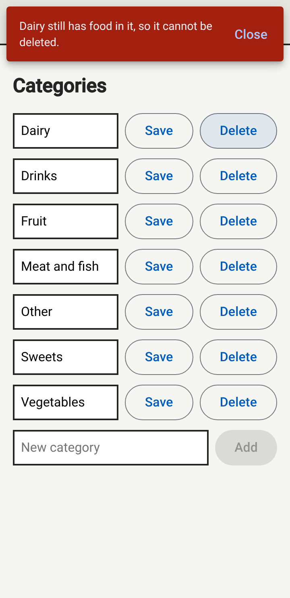 | 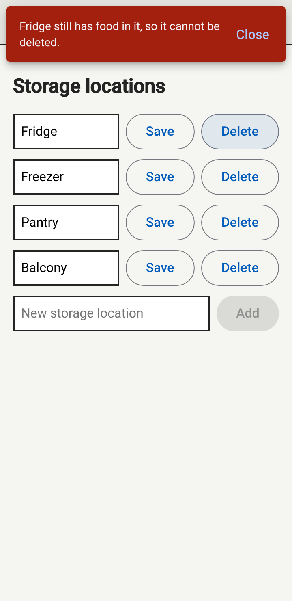 |

| No food yet |
|---|
| 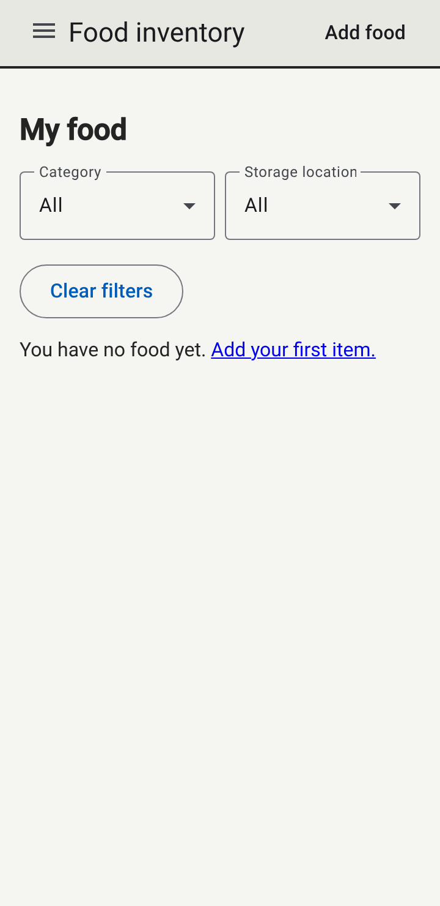 |

## API endpoints

The same five endpoints for each of the three resources: `FoodItem`, `Category` and `StorageLocation`. The data is JSON; dates are `"YYYY-MM-DD"`.

| Method | Address | What it does | Answers |
|---|---|---|---|
| GET | `/api/FoodItem` | all food items, soonest best before date first, with the names of category and storage location | 200 |
| GET | `/api/FoodItem/{id}` | one food item | 200, 404 |
| POST | `/api/FoodItem` | adds a food item | 200, 400 with a message when the input is wrong |
| PUT | `/api/FoodItem` | updates a food item: the whole object in the body, id included | 200, 400, 404 |
| DELETE | `/api/FoodItem/{id}` | deletes a food item | 204, 404 |
| GET | `/api/Category`, `/api/StorageLocation` | all categories / storage locations | 200 |
| GET | `/api/Category/{id}`, `/api/StorageLocation/{id}` | one of them | 200, 404 |
| POST | `/api/Category`, `/api/StorageLocation` | adds one | 200, 400 |
| PUT | `/api/Category`, `/api/StorageLocation` | renames one | 200, 400, 404 |
| DELETE | `/api/Category/{id}`, `/api/StorageLocation/{id}` | deletes one | 204, 404, 409 with a message when it still has food in it |

Example of a food item:

```json
{
  "id": 2,
  "name": "Milk",
  "quantity": 1,
  "purchaseDate": "2026-11-12",
  "bestBeforeDate": "2026-11-16",
  "categoryId": 1,
  "storageLocationId": 1,
  "categoryName": "Dairy",
  "storageLocationName": "Fridge"
}
```

## Database

Every food item has exactly one storage location and at most one category. The example data: 3 storage locations, 6 categories and 12 food items (21 rows).

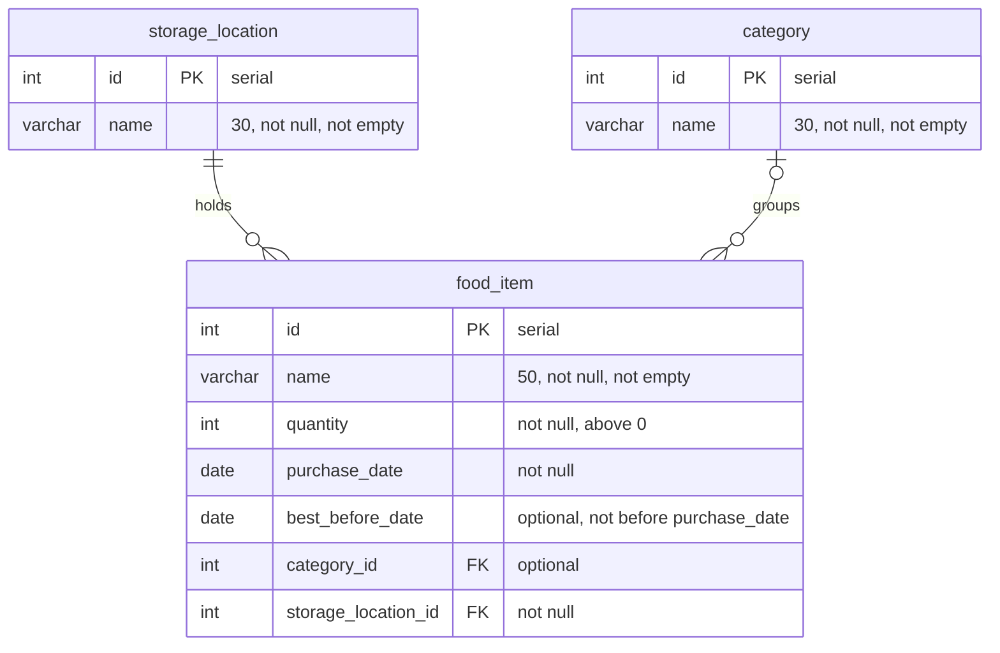

## Course concepts in this project

| # | Concept | Where to see it |
|---|---|---|
| 1 | **Interpolation** with double curly braces, reading **signals**: `{{ title() }}` in the toolbar, `{{ message() }}` on the food list. What arrives from the API is kept in a signal (`foodItems = signal<FoodItem[]>([])`), set in `subscribe` with `.set(...)` and read as `foodItems()`, so the page is drawn again by itself. | `Frontend/FoodInventory.NG/src/app/app.ts` and `app.html`; `food-item-list/food-item-list.ts` and `food-item-list.html` |
| 2 | Angular is **component based**: one folder per component; small components talk through `@Input()` (parent to child) and `@Output()` (child to parent). | `food-item-card/food-item-card.ts` (`@Input() foodItem`, `@Output() changed`), used in `food-item-list.html` as `<app-food-item-card [foodItem]="foodItem" (changed)="loadFoodItems()" />` |
| 3 | The data between frontend and API is **JSON**. | `Frontend/FoodInventory.NG/src/app/http-common.ts` (the JSON headers), `services/food-item-service.ts`; the same JSON in Swagger |
| 4 | **Websites are consumed by users, Web APIs are consumed by systems.** The Angular app is the website; the ASP.NET Core API is consumed by the Angular app (and by Swagger). | `Frontend/FoodInventory.NG/` (website), `Backend/FoodInventory.API/Controllers/FoodItemController.cs` (API), `services/` (the consumer) |
| 5 | **PUT updates a resource**: the whole object in the body. | `UpdateFoodItem` in `FoodItemController.cs`; `updateFoodItem` in `services/food-item-service.ts`; used by `edit-food-item.ts` and by "Ate one" in `food-item-card.ts` |
| 6 | **The backend manages the database and the business logic.** Validation: `[Required]`, `[Range]` on the entities (400 with a message) and the date rule in the controller. The rule "a category that still has food cannot be deleted": the foreign key refuses, the controller answers 409. | `Backend/FoodInventory.Model/Entities/FoodItem.cs`, `Repositories/FoodItemRepository.cs`, `DeleteCategory` in `CategoryController.cs`, `Database/food_inventory.sql` |
| 7 | **Models**: the data classes, the same fields on both sides. | `Frontend/FoodInventory.NG/src/app/model/food-item.ts` and `Backend/FoodInventory.Model/Entities/FoodItem.cs` |

More from the lectures:

| Lecture | Topic | Where to see it |
|---|---|---|
| 3 | Tables with primary and foreign keys, `check` | `Database/food_inventory.sql` |
| 4 | Web API: controllers, repositories on `BaseRepository`, dependency injection (`AddScoped`), Swagger while developing, connection string `AppProgDb` | `Backend/FoodInventory.API`, `Backend/FoodInventory.Model` |
| 5 | Components, routing, zone.js | `app.routes.ts`, `food-item-list`, `food-item-card`, `main.ts`, `app.config.ts` |
| 6 | Services with `HttpClient` and Observables, `ngOnInit` + `subscribe`, `@if`, `@for ... track`, CORS | `services/`, every component, `Program.cs` |
| 7 | Validation in three layers (form, API, database); template form with `[(ngModel)]`, `required`, `#name="ngModel"`; `@Input() id` from the route | `edit-food-item`, the entities, `food_inventory.sql`, `app.config.ts` |
| 8 | Angular Material: toolbar, menu, card; reactive form with `FormControl`, `Validators`, `mat-form-field`, `mat-error` | `app.html`, `add-food-item` |
| 9 | Unit tests with xUnit and Moq; Karma and Jasmine with `provideHttpClientTesting` and `HttpTestingController` | `Backend/FoodInventory.Tests`, the `*.spec.ts` files, `karma.conf.js` |
| 10 | Material cards with icon buttons, confirmation before delete and reload after it, filter with "Showing X of Y", snackbars for feedback, `navigate(["/food-items"])` after Update | `food-item-card`, `food-item-list`, `services/notification-service.ts`, `edit-food-item.ts` |

## Credits

- The course *Designing and Developing Digital Business Applications* at CBS and its course project **CourseAdminSystem**: this app follows its structure (`.API` and `.Model` projects, `BaseRepository`, list / card / add / edit components, one service per controller).
- README layout, the animated architecture picture and the single `http-common` file for the API address are inspired by Giacomo Sanna's [crud-app](https://github.com/Giacomo-Sanna/crud-app).
