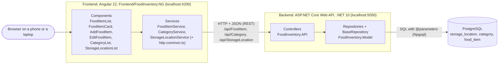
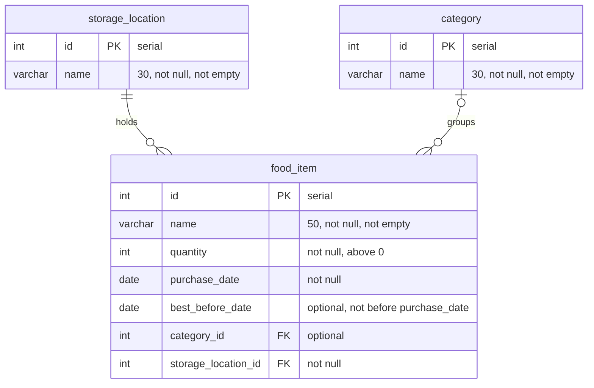

# Architecture

How the app is built and why, with pointers to the code. Lecture 1 calls this the blueprint of the system: a layered full-stack application, built like the course project CourseAdminSystem. Where the course has a *Student*, this app has a *FoodItem*; where it has a *Teacher*, this app has a *Category* and a *StorageLocation*.

## Layers

| Layer (Lecture 1) | Where | What it does |
|---|---|---|
| Presentation | `Frontend/FoodInventory.NG/src/app` | Shows the data, checks the forms, calls the API through the services |
| Application (Web API) | `Backend/FoodInventory.API` | Receives HTTP requests, checks the input and the business rules, answers with JSON and a status code |
| Data | `Backend/FoodInventory.Model` + PostgreSQL | One repository per table runs the SQL; the database keeps the data and enforces the keys and checks |

Each layer only talks to the next one. The API is stateless (Lecture 4): every request carries everything it needs. A website is consumed by users, a Web API by systems: here the Angular app (and Swagger) consume the API.

## Database (ER model)

The database from `Database/food_inventory.sql` (Lectures 2 and 3): three tables linked by two foreign keys. GitHub draws the diagram below; in pgAdmin, right click the database and choose *ERD For Database* for the same picture.

- One storage location holds many food items; every food item has exactly one storage location.
- One category groups many food items; a food item can have no category.
- The foreign keys have no `on delete`, so the database refuses to delete a category or storage location that still has food. The API turns that refusal into 409 Conflict with a message, and the page shows it in a snackbar.
- The checks (not null, not empty, quantity above 0, best before not before purchase) are the database layer of validation (Lecture 7).
- Dates are plain `date` values (no time, no time zone), `DateOnly` in C# and `"YYYY-MM-DD"` in JSON.
- `Database/setup.sql` creates the database if it is missing and runs `food_inventory.sql`; tables are created with `if not exists` and the example rows (3 storage locations, 6 categories, 12 food items) only go into empty tables, so running it twice adds nothing. The food items get their ids in the order the app lists them (`order by`), so Chicken breast is 1 and Milk is 2. The food dates are counted from the day the script runs, so the list always has expired, soon expiring and fine food.

## One request from click to database and back: adding a food item

1. **Form** (`add-food-item.ts`, Lecture 8): the reactive form checks the fields with `Validators`; a wrong field shows its `mat-error` and Add stays disabled. `addFoodItem()` checks `foodItemFormGroup.valid` once more and shows an error snackbar if not.
2. **Service** (`services/food-item-service.ts`, Lecture 6): `addFoodItem(...)` sends `POST http://localhost:5050/api/fooditem` (the address comes from `http-common.ts`) with
   `{"id":0,"name":"Bread","quantity":3,"storageLocationId":3,"categoryId":6,"purchaseDate":"2026-11-18","bestBeforeDate":null}` and returns an Observable.
3. **Browser and CORS** (`Program.cs`, Lecture 6): the page comes from port 4200 and the API is on 5050, so the browser asks first; `UseCors` allows `http://localhost:4200`.
4. **ASP.NET Core** (`[ApiController]`): the JSON is bound to the `FoodItem` entity and its data annotations are checked (`[Required]`, `[Range]`, `[StringLength]`). A wrong body gets 400 with the messages before the controller runs.
5. **Controller** (`FoodItemController.Post`): the cross-field rule (best before not before purchase) → 400 with a message; otherwise `Repository.InsertFoodItem(foodItem)`. The repository was given to the constructor by dependency injection (`AddScoped` in `Program.cs`, Lecture 4).
6. **Repository** (`FoodItemRepository.InsertFoodItem`): `insert into food_item ... values (@name, @quantity, ...)` with typed parameters, run by `InsertData` from the course's `BaseRepository`. PostgreSQL checks the constraints and the foreign keys (an unknown storage location id → the controller answers 400).
7. **Answer**: `200 OK`. Back in Angular, `subscribe({ next: ... })` shows the snackbar "Bread added" (`NotificationService`, Lecture 10) and navigates to `/food-items`.
8. **List** (`food-item-list.ts`): `ngOnInit` sends `GET /api/fooditem`; the repository's `select ... left join category ... join storage_location ... order by best_before_date, name` comes back as JSON; `this.foodItems.set(...)` updates the signal and the page shows the new card in its place.

## API

The route of each controller is `api/[controller]`. JSON is camelCase. Swagger (only while developing) is at http://localhost:5050/swagger.

| Method and path | Success | Errors |
|---|---|---|
| `GET /api/FoodItem` | 200, soonest best before date first, with `categoryName` and `storageLocationName` | |
| `GET /api/FoodItem/{id}` | 200 | 404 |
| `POST /api/FoodItem` | 200 | 400 with a message: missing name, quantity below 1, missing purchase date, storage location 0, best before before purchase, unknown category or storage location |
| `PUT /api/FoodItem` (the whole item, id included) | 200 | 400 as for POST, 404 `Food item with id 999 not found` |
| `DELETE /api/FoodItem/{id}` | 204 | 404 `Food item with id 999 not found` |
| `GET /api/Category`, `GET /api/StorageLocation` | 200 (categories by name, storage locations by id) | |
| `GET /api/Category/{id}`, `GET /api/StorageLocation/{id}` | 200 | 404 |
| `POST /api/Category`, `POST /api/StorageLocation` | 200 | 400 `Name is required`, `Name can be at most 30 characters` |
| `PUT /api/Category`, `PUT /api/StorageLocation` | 200 | 400, 404 `Category with id 999 not found` |
| `DELETE /api/Category/{id}`, `DELETE /api/StorageLocation/{id}` | 204 | 404, 409 `Dairy still has food in it, so it cannot be deleted.` |

The controllers follow the course's `TeacherController` (Exercise 6.2): `NotFound()` for a GET of an unknown id, `NotFound($"... not found")` for PUT and DELETE, `Ok()` after POST and PUT, `NoContent()` after DELETE, `BadRequest(...)` when the body is missing.

## Validation in three layers (Lecture 7)

| Rule | Form (client) | API (server) | Database |
|---|---|---|---|
| Name required, not only spaces | `Validators.required` + `pattern('.*\\S.*')` (add), `required pattern=".*\S.*"` (edit) | `[Required]` | `not null check (name <> '')` |
| Name at most 50 / 30 characters | `Validators.maxLength(50)`, `maxlength` | `[StringLength(50)]`, `[StringLength(30)]` | `varchar(50)`, `varchar(30)` |
| Quantity at least 1 | `pattern('[1-9][0-9]*')` | `[Range(1, int.MaxValue)]` | `check (quantity > 0)` |
| Purchase date required | `Validators.required`, `required` | `[Required] DateOnly?` | `not null` |
| Storage location required | `Validators.required` | `[Range(1, ...)]` | `not null` + foreign key |
| Best before not before purchase (cross-field) | `bestBeforeTooEarly()` | in `FoodItemController` | `check (best_before_date >= purchase_date)` |
| A category or storage location with food cannot be deleted (business rule) | the snackbar shows the reason | 409 Conflict | foreign key |

The form gives immediate feedback (the weakest layer, not for security); the API enforces the rules for every client (Swagger, Postman); the database is the last line of defense. The messages in `FoodItem.cs`, `Category.cs`, `StorageLocation.cs` and the two forms are kept the same (only the forms say "Quantity must be a whole number, at least 1", because a number field also accepts 1.5): change them together.

## Security

- **SQL injection:** every query uses parameters (`cmd.Parameters.AddWithValue("@name", NpgsqlDbType.Text, ...)`), never text glued into SQL.
- **XSS:** Angular escapes everything shown with `{{ }}`; the app uses no `innerHTML`.
- **CORS:** only the Angular app (`http://localhost:4200`) may call the API from a browser. Lecture 6 allows any origin; Lecture 10's security part advises to name the allowed origin.
- **Input validation** on the server: see above. The messages of the rules and of the 404 and 409 answers are written for the user (a body that is not valid JSON, or a date like 2026-13-45, gets ASP.NET Core's own 400 text, which names .NET types). An unexpected error (for example a wrong database password) shows its stack trace only while developing; outside `Development` ASP.NET Core answers 500 without details.
- **Swagger** is only switched on while developing (`app.Environment.IsDevelopment()`).
- **Secrets:** `appsettings.json` has the local course password (`postgres`). A shared or cloud database gets its connection string from an environment variable instead, so the password never goes to GitHub: `ConnectionStrings__AppProgDb="<connection string>" dotnet run --project FoodInventory.API`.
- **HTTPS:** not used on localhost (Lecture 4 removes `UseHttpsRedirection` to avoid certificate problems); a deployment would need it.
- **No login:** the roadmap says "Login and multi-user features are optional and are not planned". Anyone who can reach the API can change the list. Lecture 10's JWT login would add, as a possible extension:
  - Database: a `users` table (`username unique`, `passwordhash`, `role`) and the `pgcrypto` extension, so passwords are stored as `crypt(password, gen_salt('bf'))`, never as text.
  - Backend: a `User` entity and an `AuthRepository.ValidateUser` that compares with `crypt(@password, passwordhash)`; the packages `Microsoft.AspNetCore.Authentication.JwtBearer`, `Microsoft.IdentityModel.Tokens`, `System.IdentityModel.Tokens.Jwt`; `AddAuthentication(...).AddJwtBearer(...)` with a key from `Jwt:Key`; `app.UseAuthentication()` before `app.UseAuthorization()`; an `AuthController` with `POST /api/Auth/login` that returns a token valid for 2 hours; `[Authorize]` (or `[Authorize(Roles = "admin")]`) on the three controllers.
  - Frontend: an `AuthService` that stores the token in `localStorage`, a `jwtInterceptor` that adds `Authorization: Bearer <token>` to every request (`withInterceptors` in `app.config.ts`), a `Login` component, an `AuthGuard` with `canActivate` on the routes, and Login/Logout buttons in the toolbar.
  - It would also bring new requirements: one inventory per household, password reset, HTTPS, and GDPR for the user data.

## Strengths and limitations

| Strengths | Limitations (and what would fix them) |
|---|---|
| Layered like the course project: easy to explain and to change one layer at a time | No login: anyone who can reach the app can change the list (Lecture 10's JWT, above) |
| Plain SQL in repositories: you can read exactly what the database does | One shared inventory: no households or users (would need accounts and a households table) |
| The same rules and messages in the form, the API and the database | Synchronous repositories: simple, but async would serve more users at once |
| The foreign keys protect the data even when the API has a bug | Category and storage location names can repeat ("Dairy" twice is accepted) |
| Phone-first layout with Angular Material; the warnings use icon and text | Runs on localhost: deploying would need a host for the API, a cloud database and HTTPS |
| Unit tests for every controller (xUnit, Moq) and every component and service (Karma, Jasmine), and CI on every pull request | The tests mock the database; the real SQL is only checked by CI's API calls and by hand |
| | No paging: fine for a household list, not for thousands of items; the icons and the font need internet (Google Fonts) |

## Business value (Lecture 1)

Households waste the most food: 60% of the 1.05 billion tonnes wasted in 2022 (UNEP Food Waste Index Report 2024). The app helps a household see what it has and eat it in time; less waste saves money. As a product it could grow with accounts, reminders before food goes off, shared households and a history of what was eaten and thrown away (US14). That would bring new requirements: authentication, hosting, and GDPR for personal data.

## Design decisions and traps

- **Plain dates:** `date` columns, `DateOnly`, `"YYYY-MM-DD"` strings, never timestamps. "Today" is the user's LOCAL date: Angular's `formatDate(new Date(), 'yyyy-MM-dd', 'en')`, never `toISOString()` (that gives the UTC day, wrong around midnight). The tests also run with `TZ=Pacific/Auckland` to catch this.
- **Signals** for what a template shows (`foodItems = signal<FoodItem[]>([])`, `{{ title() }}`, `foodItems()`), as in Lecture 6's theory and Lecture 10's `app.ts`; with zone.js as in Lectures 5, 7 and 10.
- **One address:** `http-common.ts` holds `baseUrl` and the JSON headers; the services import it.
- **Foreign keys** do the business rule "a category or storage location with food cannot be deleted"; the controller catches PostgreSQL's error 23503 and answers 409.
- **Mobile:** text 16 px (phones zoom in on smaller form text), buttons and fields at least 44 px, no sideways scrolling at 360 px, one column of at most 430 px.
- **Less is more:** no library, file or abstraction that a story does not need. No Entity Framework (the course uses plain SQL with Npgsql).

## Likely oral-exam questions

- **What is a Web API, and why REST?** A contract over HTTP: endpoints, methods, JSON in and out, status codes. REST uses the standard methods: GET reads, POST creates, PUT updates, DELETE deletes; it is stateless. See `Controllers/`.
- **Walk through what happens when you add a food item.** See [One request](#one-request-from-click-to-database-and-back-adding-a-food-item).
- **What does a repository do?** It holds all the SQL for one table. `BaseRepository` (from the course) opens the connection and runs the command; controllers never write SQL.
- **Where is dependency injection?** `builder.Services.AddScoped<FoodItemRepository, FoodItemRepository>()` in `Program.cs`. ASP.NET Core creates one repository per request and passes it to the controller's constructor; in the tests Moq passes a fake one.
- **What do `[ApiController]` and `[Route("api/[controller]")]` do?** An invalid body gets a 400 automatically, and the URL comes from the class name: `FoodItemController` is `/api/FoodItem`.
- **Why `virtual` in the repositories?** Moq can only replace virtual methods (Lecture 9: the first test fails without it).
- **What happens when you delete a category that still has food?** The foreign key refuses; the controller catches the PostgreSQL error and answers 409 with "Dairy still has food in it, so it cannot be deleted."; the page shows it in a red snackbar.
- **Why validate in the form, the API and the database?** The form gives quick feedback but can be skipped (Swagger, Postman); the API enforces the rules for every client; the database is the last guard against a bug or a script.
- **How do the components talk to each other?** `@Input() foodItem` passes data from the list to the card; `@Output() changed` tells the list to load the food again after Ate one or Delete. The services are shared by all components.
- **What is two-way binding?** `[(ngModel)]` keeps a field and a variable equal in both directions (`edit-food-item.html`, the filters, the category names).
- **Template-driven or reactive form?** The edit form is template-driven (Lecture 7: `required`, `#name="ngModel"`); the add form is reactive (Lecture 8: `FormControl`, `Validators`, `mat-error`).
- **What is a signal, and what does zone.js do?** A signal is a value the template reads with `()`; when `.set(...)` changes it, Angular updates the page. zone.js tells Angular when something happened (a click, an HTTP answer), so it can check the page.
- **How does routing work?** `app.routes.ts` maps `/food-items`, `/add-food-item`, `/edit-food-item/:id`, `/categories`, `/storage-locations` to components, and `**` sends any other address to the list; `withComponentInputBinding()` puts `:id` into `@Input() id`; the page appears in `<router-outlet />`.
- **What is CORS?** The browser only lets a page call an API on another origin if the API allows it; `UseCors` allows `http://localhost:4200`.
- **What would you do differently or next?** Login (JWT, Lecture 10), unique names, a deployment, US14 history.

## Where each lecture shows up in the code

| Lecture | The course | In this project |
|---|---|---|
| L01 | Layered architecture, REST API; Scrum; CI/CD with automated testing; the project (report max 10 pages, oral exam) | [Layers](#layers); [BACKLOG.md](BACKLOG.md); `.github/workflows/tests.yml`; [REPORT-AND-EXAM.md](REPORT-AND-EXAM.md) |
| L02 | User stories, INVEST, acceptance criteria, Definition of Done; wireframes, UI design, prototype; mobile first; loading and error states; privacy, SQL injection, XSS, accessibility | [BACKLOG.md](BACKLOG.md); Figma (link in the README); 360 px layout; "Loading...", empty and error states; [Security](#security) |
| L03 | Tables with primary and foreign keys, `check` and `on delete` (`CreateTables-DDL.sql` with its test data; the ShoeX dataset) | `Database/food_inventory.sql`, in the same style: the keys and checks inside `create table` |
| L04 | `dotnet new sln`, `webapi --use-controllers`, `classlib` `.Model`; Npgsql; `AppProgDb` in `appsettings.json`; `BaseRepository`; entity with an `(int id)` constructor and `DateOnly`; repository; controller; `AddScoped`; `<Nullable>disable</Nullable>`; no `UseHttpsRedirection`; Swagger with `Swashbuckle.AspNetCore` and `Swashbuckle.AspNetCore.SwaggerUI`, `launchUrl` swagger; the course database from `SQLScriptForDatabase.sql` in pgAdmin's Query Tool | `Backend/FoodInventory.slnx`, `FoodInventory.API`, `FoodInventory.Model`, `Program.cs`, `Properties/launchSettings.json`; `Database/food_inventory.sql` (runs the same way in pgAdmin's Query Tool) |
| L05 | `ng new ....NG` with zone.js; `ng generate component` / `interface`; list and card with `@for` and `@Input()`; routes and `routerLink` | `Frontend/FoodInventory.NG`; `model/`; `food-item-list`, `food-item-card`; `app.routes.ts` |
| L06 | `ng generate service`; `HttpClient`, Observables; `provideHttpClient()`; `ngOnInit` + `subscribe`; `UseCors` above `UseAuthorization`; signals, `@if`, `@for ... track`; delete in the card | `services/`, `app.config.ts`, every component, `Program.cs` |
| L07 | `ng generate component EditStudent`, `withComponentInputBinding()`, zone.js in `main.ts`; `@Input() id`; `[(ngModel)]`; `required`, `pattern`, `#x="ngModel"`, `@if (...invalid) {Error in data} @else {Update}`; validation in three layers | `edit-food-item`, `main.ts`, `app.config.ts`, [Validation](#validation-in-three-layers-lecture-7) |
| L08 | `ng add @angular/material` (azure/blue); `mat-toolbar`, menu with `[matMenuTriggerFor]`; `AddStudent` with `FormControl`, `FormGroup`, `Validators`, `mat-form-field`, `mat-error`, `mat-raised-button` | `app.html`, `styles.css`, `add-food-item` |
| L09 | xUnit + Moq tests of the controllers (`virtual`); Karma and Jasmine (helper slide), `provideRouter([])`, `provideHttpClient()`, `provideHttpClientTesting()`, a mock for `@Input`, `HttpTestingController`; security basics, CORS | `Backend/FoodInventory.Tests`, `karma.conf.js`, the `*.spec.ts` files, [Security](#security) |
| L10 | JWT login (documented above as an extension); delete with confirmation and reload; `navigate(["/food-items"])` after Update; search/filter with "Showing X of Y"; Material cards with icon buttons; snackbars with `NotificationService` | [Security](#security); `food-item-card`, `food-item-list`, `edit-food-item.ts`, `services/notification-service.ts` |
| E02.1 | One cloud database for the team (Supabase) | README: the connection string in an environment variable |
| E04.1 | Test the API with Postman | Swagger or Postman: `GET http://localhost:5050/api/FoodItem` |
| E06 | `TeacherRepository`, `TeacherController`, `TeacherService` | the repositories, controllers and services |

Kept different on purpose:

| The course | Here, and why |
|---|---|
| `baseUrl` field in every service (Lecture 6) | one `http-common.ts` with `baseUrl` and the JSON headers: the address is in one place |
| `AllowAnyOrigin()` (Lecture 6) | only `http://localhost:4200` (Lecture 10's security advice) |
| `track $index` (Lecture 5) | `track foodItem.id` as in Lecture 10's list: each card stays with its item when the list changes |
| `this.students = students` plus `markForCheck()` | signals (`this.foodItems.set(...)`), as in Lecture 6's theory and Lecture 10's `title = signal(...)` |
| A table with `border` (Lecture 5) | Material cards (Lecture 10) that fit a 360 px phone |
| One search field (Lecture 10) | two filters, by category and by storage location (US10 asks for them) |
| Login (Lecture 10) | not built: the roadmap does not plan it; documented as an extension |
| Routes without a catch-all (Lecture 5) | `{ path: '**', redirectTo: '/food-items' }`: a wrong address opens the list instead of an empty page |
| `SQLScriptForDatabase.sql` (Lecture 4): `drop table` first, then `create sequence` and `alter table` for the defaults and the keys | `create table if not exists` with `serial` (one word for the sequence and its default) and the keys inside the table, as in Lecture 3's `CreateTables-DDL.sql`; no `drop`, so running it again keeps the data |
| `on delete cascade` (Lecture 4's script) or `on delete set null` (Lecture 3) | no `on delete`: the database refuses to delete a category or storage location that still has food, and the API answers 409 (US9, US13). Cascade would delete the food with it; `set null` would leave the food without a category |
| Port 5150 (CourseAdminSystem's `launchSettings.json`) | port 5050, the team's choice from the start; in the code it is only in `launchSettings.json` and `http-common.ts` |
| `material-theme.scss` from `ng add` plus `indigo-pink.css` in `styles.css` (the course's code after Lecture 8) | one prebuilt theme, `azure-blue.css`, imported in `styles.css`: the same azure and blue colours without a Sass file |
