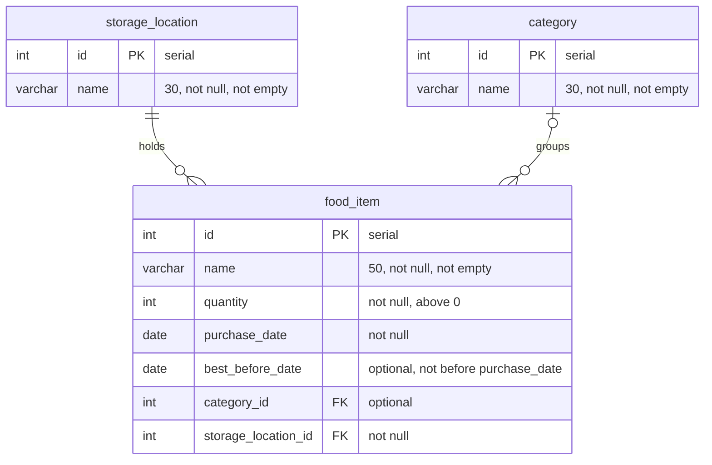

# ER diagram

The database from `database.sql` (Lectures 2 and 3): three tables, linked by two foreign keys. GitHub draws the diagram below; in pgAdmin, right click the database and choose ERD For Database for the same picture.

* One storage location holds many food items; every food item has exactly one storage location.
* One category groups many food items; a food item can have no category.
* The foreign keys refuse to delete a category or storage location that still has food. The API turns that refusal into 409 Conflict with a message, and the Settings page shows it.
* The checks (not null, not empty, quantity above 0, best before not before purchase) are the database layer of validation (Lecture 7); the form is the other layer.
* Example data: 3 storage locations, 6 categories and 6 food items (15 rows).
